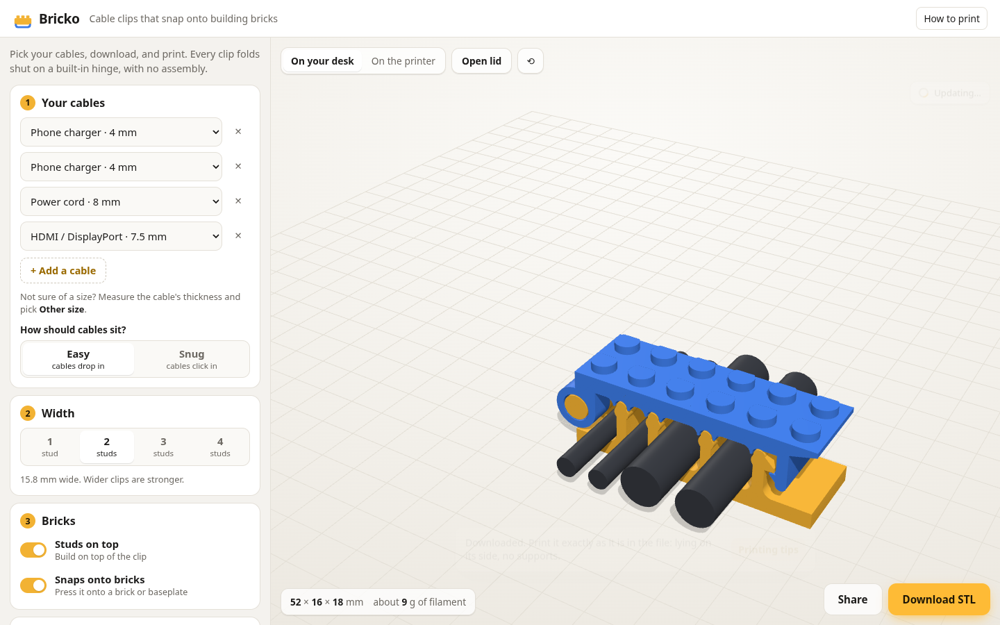
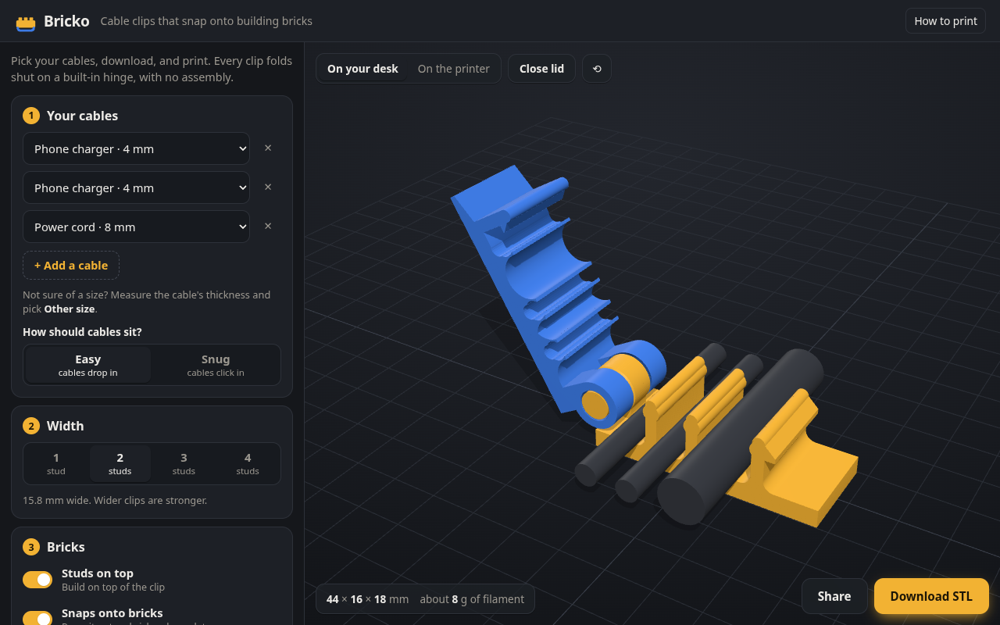

# Bricko

**Print-in-place, brick-compatible cable clips, made to measure.**

**▶ Open it: https://souzagab.github.io/bricko/**

Pick the cables you want to tidy, see the clip update in 3D, and download an STL that prints on any FDM printer. No supports and no assembly needed. The clip folds shut on a hinge that prints in one piece, locks with a hook latch, has studs on top to build on, and snaps onto building bricks or baseplates underneath. Everything runs in your browser: nothing is uploaded and there's no account.



## How it works

1. **Pick your cables** by name (phone charger, HDMI, power cord…) or type a thickness. The clip sizes itself around them.
2. **Choose the width** (1–4 studs), whether it has studs on top and sockets underneath, and how tight the hinge should be.
3. **Download the STL** and print it as it is: lying on its side, no supports.

Not sure about your printer? **Print a fit test**: five mini clips, each a little looser than the last. Then click the ones that fit best to apply them. Everything else (exact sizes, hinge, latch, brick dimensions, printer settings) is under **Advanced settings**. Brick sizes default to the standard system: 8.0 mm pitch, 4.8 mm studs 1.7 mm tall, 3.2 mm plates.



**Every model is checked before you can download it:**
- two separate solid parts that never touch, with every gap at least the clearance
- the hinge opens to 170° without hitting anything except the latch
- the STL is a watertight mesh

Your design lives in the URL, so **Share** gives you a link that rebuilds it exactly.

> Status: website and geometry engine working, waiting on the first physical prints. Feedback is welcome in [issues](https://github.com/souzagab/bricko/issues).

## Development

```bash
npm install
npm run dev        # http://localhost:5173: settings, live 3D preview, STL download, share links, test print
npm run build      # static site in dist/ (relative paths: host anywhere)
npm run preview    # serve the build
npm run check      # svelte-check (types + a11y)
npm run shots      # headless-Chromium smoke test with screenshots (needs a Chromium; CHROME=/path to override)
```

**Deploy:** push to GitHub and enable Pages (Settings → Pages → Source: GitHub Actions). `.github/workflows/pages.yml` then type-checks, tests, builds and publishes on every push to `main`.

**Architecture:**
- **UI:** Svelte 5. Every control is generated from the zod parameter schema.
- **Geometry:** runs in a Web Worker (manifold-3d WASM); only the newest request is kept, so dragging a slider never piles up builds.
- **Viewer:** three.js, rendered on demand: in-use / as-printed views, live opening angle, section cut.
- **Export:** the STL is written in the browser. Nothing is uploaded.

## Command line

```bash
npm install
npm test                                   # invariants, kinematics, fuzzing
node cli/gen.ts -o clip.stl                # default clip
node cli/gen.ts --preset usbc -o usbc.stl  # presets: default usbc power hdmi bundle slim mixed snap tight
node cli/gen.ts --set channelCount=3 --set channelWidth=7 --set clearance=0.3 -o mine.stl
node cli/gen.ts --all-presets -o out/
```

Requires Node ≥ 23.6, which runs TypeScript directly.

| Doc | What's in it |
|---|---|
| [docs/PLAN.md](docs/PLAN.md) | Decisions, architecture, parameter set, validation rules, tests and milestones |
| [docs/GEOMETRY.md](docs/GEOMETRY.md) | Brick dimensions (with derivations), FDM design rules and print orientation |
| [docs/RESEARCH.md](docs/RESEARCH.md) | Research findings, with sources |

## License

[AGPL-3.0-only](LICENSE). If you host a modified version, you must publish its source.

## Notes

"Brick-compatible" means it fits standard 8 mm-pitch building bricks and baseplates.
