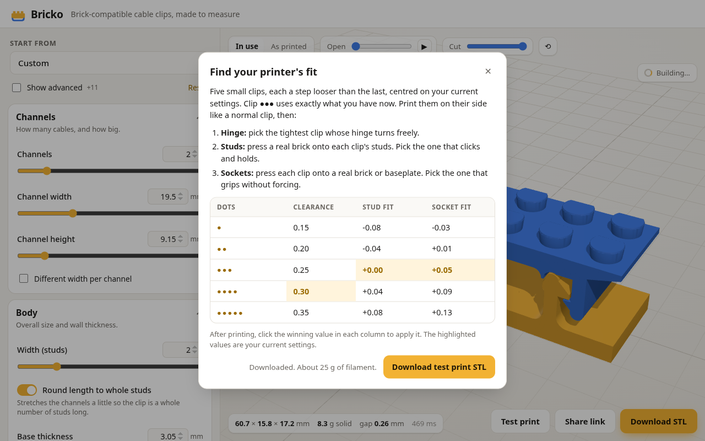

# Bricko

**Print-in-place, brick-compatible cable clips, made to measure.**

**▶ Open it: https://souzagab.github.io/bricko/**

Set your cable sizes and see the clip update in 3D. Then download an STL that prints on any FDM printer: no supports, no assembly. The clip folds shut on a print-in-place hinge, locks with a hook latch, has studs on top for real bricks, and presses onto bricks or baseplates underneath. It all runs in your browser. Nothing is uploaded, and you don't need an account.


## Features

- **Fully parametric:** channel count, per-channel widths, height, clip width in studs, hinge, latch, studs and sockets. Every control comes with validation, help text and automatic adjustments.
- **Live 3D preview:** in-use and as-printed views, a hinge-opening slider, and a section cut through the width.
- **Test print:** five small clips, each a step looser than the last, marked with 1–5 dots. Print them once, then click the winners to apply your printer's best clearance, stud fit and socket fit.
- **Share links:** your design lives in the URL.
- **Safe output:**
  - every model is checked before you can download it: two separate solid parts, never touching, every gap at least the clearance
  - the hinge opens to 170° with nothing hitting except the latch
  - the STL is a watertight mesh
- **Free software** (AGPL-3.0).



## Printing

Print the STL **as downloaded**, lying on its side with the hinge axis vertical. No supports. PETG or PLA+ is recommended. Start with the test print to dial in your printer. The full guide is in the app under *How to print*.

> Status: website and geometry engine working, waiting on the first physical prints. Feedback is welcome in [issues](https://github.com/souzagab/bricko/issues). See [docs/PLAN.md](docs/PLAN.md).

## Development

```bash
npm install
npm run dev        # http://localhost:5173: settings, live 3D preview, STL download, share links, test print
npm run build      # static site in dist/ (relative paths: host anywhere)
npm run preview    # serve the build
npm run check      # svelte-check (types + a11y)
npm run shots      # headless-Chromium smoke test with screenshots (needs a Chromium; CHROME=/path to override)
```

**Deploy:** push to GitHub and enable Pages (Settings → Pages → Source: GitHub Actions). `.github/workflows/pages.yml` then type-checks, tests, builds and publishes on every push to `main`.

**How it works:**
- **UI:** Svelte 5. Every control is generated from the zod parameter schema.
- **Geometry:** runs in a Web Worker (manifold-3d WASM); only the newest request is kept, so dragging a slider never piles up builds.
- **Viewer:** three.js, rendered on demand: in-use / as-printed views, live opening angle, section cut.
- **Export:** the STL is written in the browser. Nothing is uploaded.

## Command line

```bash
npm install
npm test                                   # invariants, kinematics, fuzzing
node cli/gen.ts -o clip.stl                # default clip
node cli/gen.ts --preset usbc -o usbc.stl  # presets: default usbc power hdmi bundle slim mixed snap original
node cli/gen.ts --set channelCount=3 --set channelWidth=7 --set clearance=0.3 -o mine.stl
node cli/gen.ts --all-presets -o out/
```

Requires Node ≥ 23.6, which runs TypeScript directly.

| Doc | What's in it |
|---|---|
| [docs/PLAN.md](docs/PLAN.md) | Decisions, architecture, parameter set, validation rules, tests and milestones |
| [docs/GEOMETRY.md](docs/GEOMETRY.md) | Brick dimensions (with derivations), FDM design rules, print orientation and a teardown of the original clip |
| [docs/RESEARCH.md](docs/RESEARCH.md) | Research findings, with sources |
| [docs/ORIGINAL-TEARDOWN.md](docs/ORIGINAL-TEARDOWN.md) | Reverse-engineered mechanism and dimensions of the original clip |

## License

[AGPL-3.0-only](LICENSE). If you host a modified version, you must publish its source.

## Notes

- "Brick-compatible" means it works with standard 8 mm-pitch construction bricks. LEGO® is a trademark of the LEGO Group, which does not sponsor, authorize or endorse this project.
- The idea came from a community "Cable Organizer Clip (Brick ver)" model. All geometry here is written from scratch.
